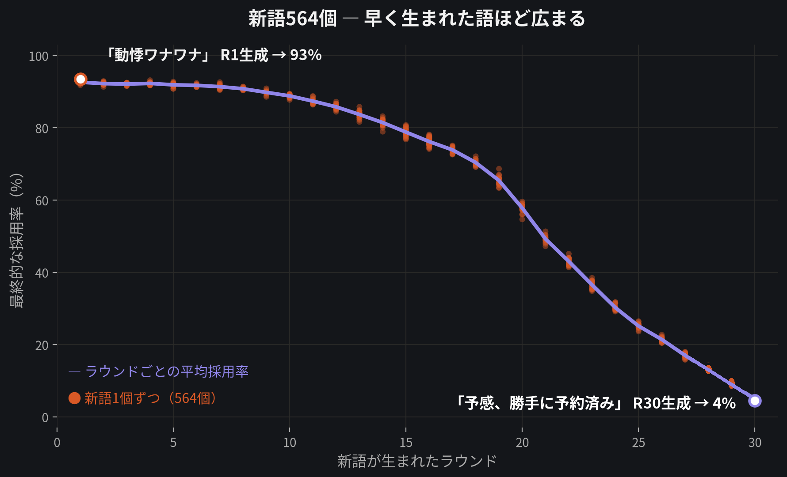
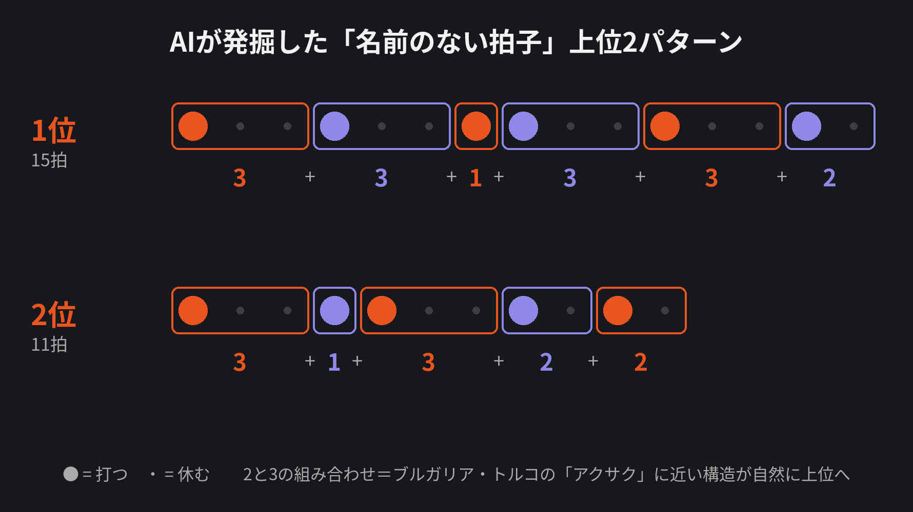
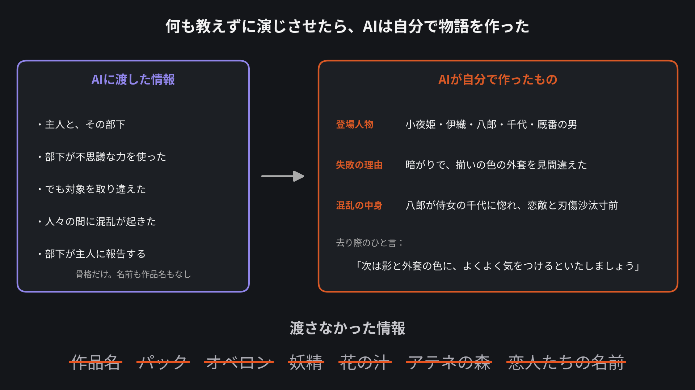
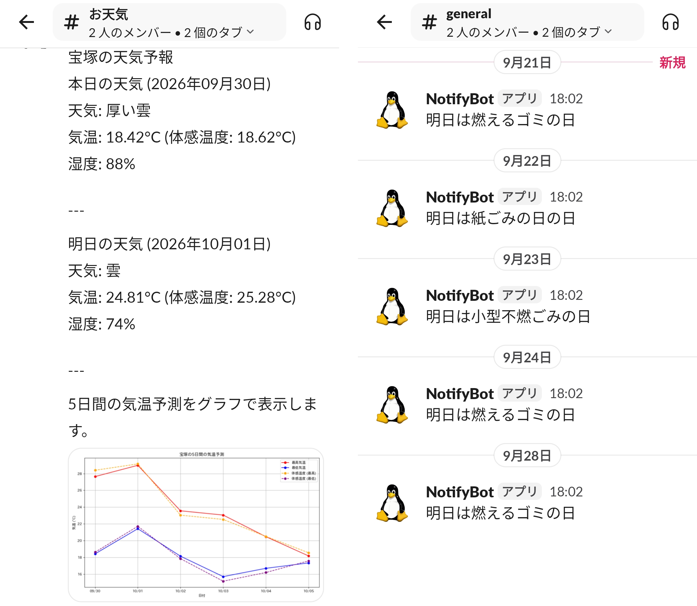
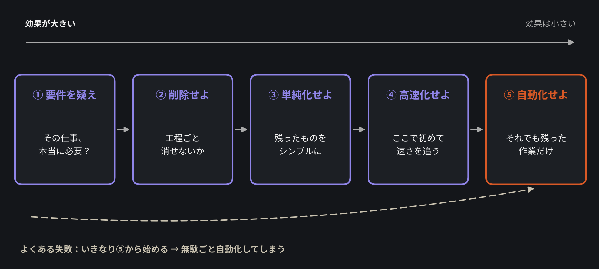

<!-- _class: title -->

# 自己紹介

### 部門会議 / [氏名]

好きなもの3つで、私という人間を紹介します

---

<!-- _class: split -->

## プロフィール

- **出身**：[出身地]
- **入社**：[入社年]年
- **経歴**：[これまでの経歴]
- **趣味**：[趣味]

<!-- 右側画像：趣味の写真を hobby.png としてこのフォルダに配置（配置後に再ビルドで埋め込み） -->

---

## 今日話すこと

1. **AIが好き** — ClaudeCodeを通して見たこの会社の特異な点
2. **Ubuntuが好き** — 実はWindowsが好きじゃないんです
3. **あなたの効率化、間違っているかも** — イーロン・マスクの5アルゴリズム

---

<!-- _class: chapter -->

CHAPTER 1

# AIが好き

---

## ClaudeCodeどっぷり

- Maxプランを契約してフル活用（現在はProにダウングレード済）
- 「仕事以外でそんなにAIって使うの？」「何してるの？」
- その疑問に、これからお応えします

---

## 中でも「研究シミュレーション」が好き

- 作って終わりでなく、実データや実行結果で検証まで回すのが好み
- 代表3プロジェクトを紹介

---

## 新語はどう広まるか

- AIキャラ**5000人**それぞれに違う性格（流行に敏感／慎重派など）を与えて会話させる実験
- 「新しい技術が流行る」「事件が起きる」といった外部イベントも時々発生させ、言葉の変化を後押し
- 1回の実験で新語が**564個**誕生、平均で6割強の人に浸透
- 人気だった新語：「動悸ワナワナ」「ゾワ期待」「喜び逆走」→ いずれも**93%超**が使うように

---

---

## 名前のない拍子を発掘する

- まだ名前のついていない「変わった拍子（非対称リズム）」をAIに探させる実験
- リズムの良さを十数個の指標で採点し、**遺伝的アルゴリズム**で世代交代させて進化。人間は最後に聴くだけ
- 23世代で**618パターン**を評価 → 2と3を混ぜるブルガリア・トルコの「**アクサク**」に近い拍子が、教えてもいないのに上位へ
- ループ動画を制作してYouTube公開（数か月でいずれも再生回数5未満）

---

---

## 何も教えずに演じさせてみる

- シェイクスピア劇を、固定の性格を持つAI俳優（目的・障害だけ与えて自由に即興させる）に演じさせる実験
- ただしシェイクスピアはAIがほぼ暗記している有名作品。作品名・登場人物名・小道具など、**作品を特定できる情報を極限まで削ぎ落として**『真夏の夜の夢』の一場面を演じさせた
- 結果：独自の和風キャラ名（小夜姫・伊織）やオリジナルの勘違いトリック（外套の色の見間違い）を自作で創作
- あらすじの骨格（人違いで恋愛が混乱する）は保ったまま、中身はゼロから創造された

---

---

## 研究シミュレーションの前は、ひたすらアプリを作っていた

- 実は最初は、**スマホアプリやWebアプリ**をたくさん作ってきた
- ClaudeCodeのおかげで、作ること自体はどんどん速く・簡単に
- でも、作ったアプリを**使ってもらう**段階で、思わぬ壁にぶつかった

---

## 営業が大変なことに気が付いた

- 作るのが速くなった分、次にぶつかった壁は「**売る**」こと
- どれだけ良いものを作っても、届かなければ意味がない
- 個人開発を重ねて痛感した、地味だが本質的な現実

---

## B2Cは広告費がいる、B2Bは信用がない

- **B2C**：知ってもらうために広告費が必要
- **B2B**：信頼してもらうための実績・看板が必要
- どちらの道も、個人には高いハードルがある

---

## 営業の無いこの会社は、ある意味特異

- 営業組織を持たずに事業が回っている
- 個人開発で痛感した「売ることの難しさ」を踏まえると、これは相当めずらしい強み
- この環境の価値を、身をもって理解できた

---

<!-- _class: chapter -->

CHAPTER 2

# Ubuntuが好き

---

## 使っているのは ubuntu / lubuntu / ubuntu-server

- Windows上のWSLは **Ubuntu**
- 自宅サーバーは **lubuntu** と **ubuntu-server**
- 気づけば、触っているLinuxは全部Ubuntu系

---

<!-- _class: split -->

## 自宅サーバーで 動かしているもの

- 自作 **Slack Bot** が毎日通知
- **朝**：天気と5日間の気温グラフ
- **夕方**：翌日のゴミの種類
- 地味だけど、生活がちょっとスムーズに

---

## 日本語の情報多い、無料、簡単

- 困ったときも日本語の情報がすぐ見つかる
- ライセンス費用は不要
- 導入・運用のハードルが低い

---

## Winにはないパッケージ管理

- `apt` で依存関係ごとサクッとインストール・アップデート
- 環境構築が再現しやすく、汚れにくい
- **Windowsに戻れなくなる理由の一つ**

---

## オマーキーが気になるこの頃

- 最近話題の **Omarchy**（Arch Linux + Hyprland ベース）が気になっている
- Ubuntu派だが、新しい潮流にはアンテナを張っておきたい
- 次に触ってみたい環境の候補

---

<!-- _class: chapter -->

CHAPTER 3

# あなたの効率化
# 間違っているかも

---

## 好きなフレームワーク： イーロン・マスクの5つのアルゴリズム

<!--
発表者メモ：
① 要件を疑え：「そもそも、その要件は本当に必要か？」を最初に問う。誰かが昔決めただけの前提が残っていないか。一番効果が大きいのは、やらなくていい仕事を見つけること
② 削除せよ：工程そのものを削れないか検討する。減らしすぎて困ったら戻せばいい。「一つも削れていない改善案」は疑う
③ 単純化せよ：削り切ってから残った部分をシンプルに。複雑な仕組みを効率化しても、複雑なまま速くなるだけ
④ 高速化せよ：ここで初めて「速さ」を追う。最初からここに飛びつくと遠回り
-->

---

<!-- _class: closing -->

## ⑤ 自動化は効率化の最後にするもの

疑って、削って、単純化して、速くして—— 
<strong class="accent-ubuntu">それでも残った作業だけを自動化する</strong>

最初から自動化に飛びつくと、"無駄を高速化する装置"が出来上がる

---

<!-- _class: closing -->

# ありがとうございました

AIが好き / Ubuntuが好き / 効率化の順番にはこだわりたい

